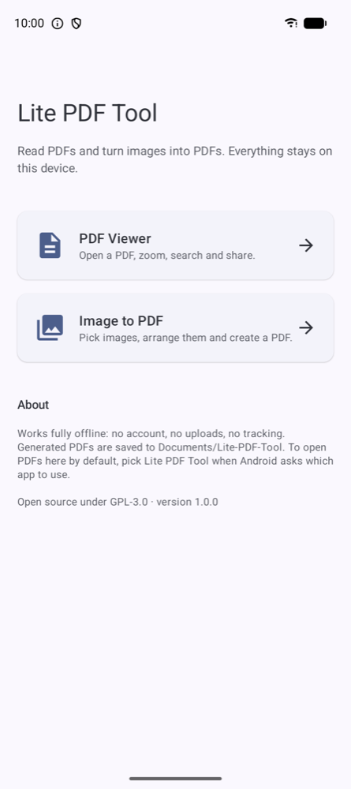
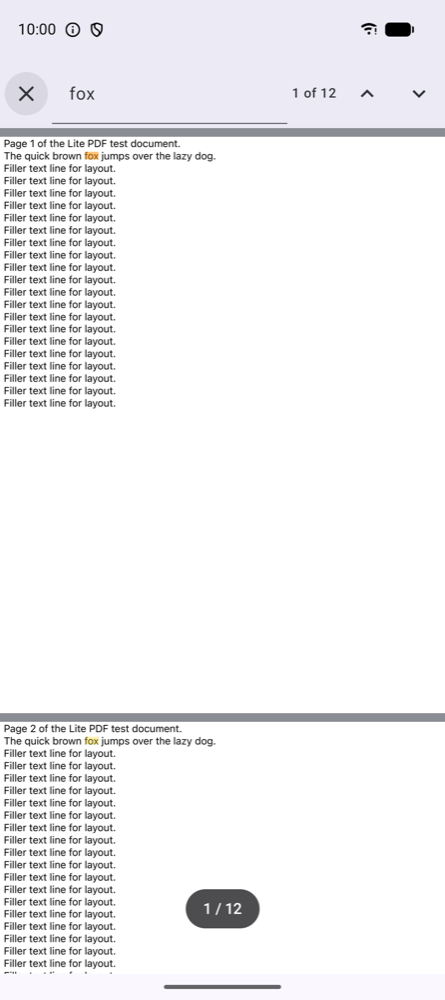
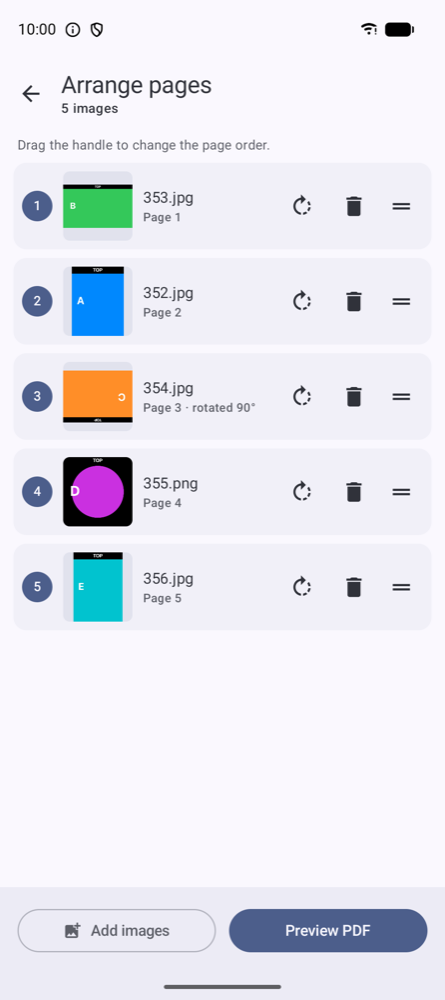
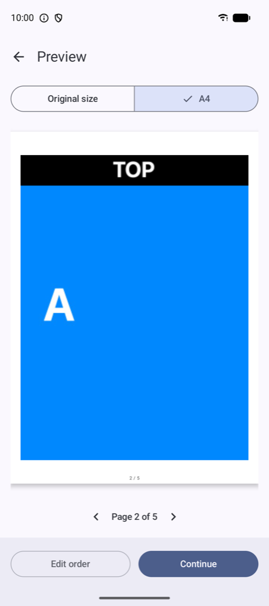
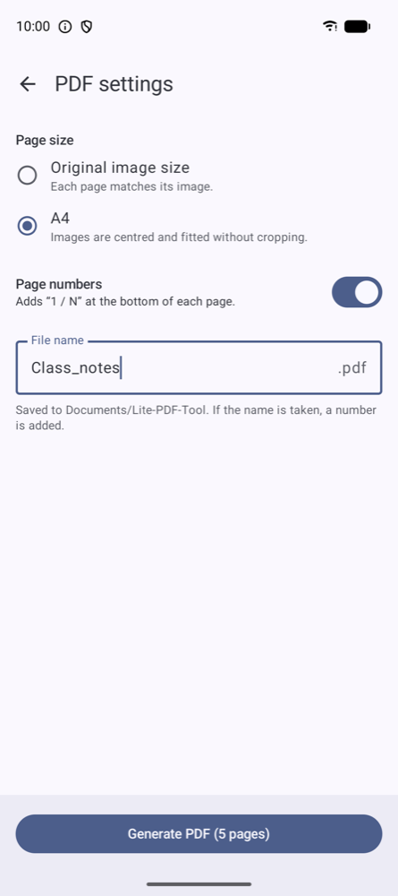
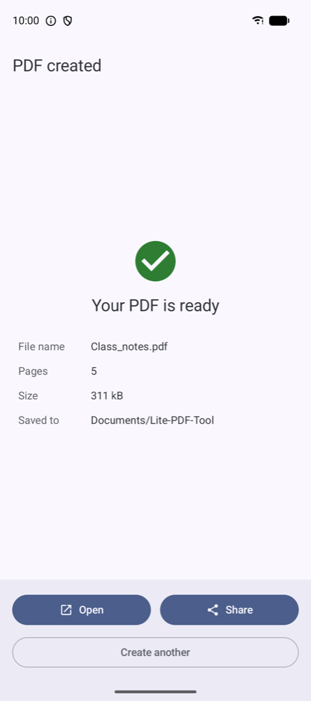

# Lite PDF Tool

A small, offline Android app that does two things: **reads PDFs** and **turns images into PDFs**.
No account, no network permission, no analytics, no document history.

- **PDF viewer**: opens PDFs from Files, Gmail, WhatsApp, browsers (`ACTION_VIEW` / `ACTION_SEND`,
  `content://` URIs only). Continuous vertical scrolling, pinch and double-tap zoom, fit to
  width, a page counter with go-to-page, text search with highlighted matches, share, and
  password-protected PDFs.
- **Image to PDF**: pick images with the system Photo Picker, add more in later batches (they
  are appended, never replacing the current order), drag to reorder, rotate, remove, preview,
  choose Original size or A4, page numbers on or off, custom file name. Output goes to
  `Documents/Lite-PDF-Tool/`; name clashes become `Name (1).pdf`.

Android 12 (API 31) and up. Licence: GPL-3.0.

## Download

[**LitePdfTool-1.0.0.apk**](https://github.com/er-shrey/lite-pdf-tool/releases/download/v1.0.0/LitePdfTool-1.0.0.apk)
(16 MB) from the [v1.0.0 release](https://github.com/er-shrey/lite-pdf-tool/releases/tag/v1.0.0).
Install it on the phone and allow installs from your browser or file manager when Android asks.
To open PDFs with it by default, choose **Lite PDF Tool** → **Always** the next time you open a PDF.

## Screenshots

| Home | Viewer with search | Arrange pages |
|:---:|:---:|:---:|
|  |  |  |
| **Preview (A4)** | **PDF settings** | **Done** |
|  |  |  |

## Build

```bash
./gradlew :app:assembleDebug        # debug APK
./gradlew :app:testDebugUnitTest    # JVM unit tests
./gradlew :app:assembleRelease      # minified, signed with the local debug key
```

Needs JDK 17+ and the Android SDK (compileSdk 36).

## How it works

| Area | Choice | Why |
|---|---|---|
| Rendering + search | PDFium via `io.legere:pdfiumandroid` behind a `PdfEngine` interface | Android's `PdfRenderer` can't search text on Android 12–14 |
| Zoom | The page list is laid out at `zoom × width`, not scaled as a picture | Scrolling, page tracking and render resolution stay correct at every zoom |
| PDF writing | Own streaming writer (`core/pdfgen/PdfWriter.kt`) | Android's `PdfDocument` keeps every page's bitmap in memory until the file is written. Here JPEGs are embedded byte-for-byte (no quality loss); other formats are decoded in strips and stored losslessly; one image is in memory at a time |
| Orientation | EXIF orientation + user rotation become the PDF image matrix | Source files are never modified or re-encoded |
| Page size | Original = pixels × 72 / DPI (EXIF DPI, else 96); A4 = fitted, centred, 24 pt margin, never upscaled | PRD §12 |
| Saving | MediaStore `Files` collection, written as a pending item, published only when complete | No storage permission; a partial file is never shown as a success, and leftovers are removed on the next launch |

Code layout: `core/` (pdfgen, pdfview, storage, ui), `viewer/`, `imagetopdf/`, `home/`.

## Not in 1.0

Compression, merge/split, PDF to images, page editing, watermarks, signing, OCR, cropping and
password-protecting output are planned for later releases (see the PRD roadmap).
